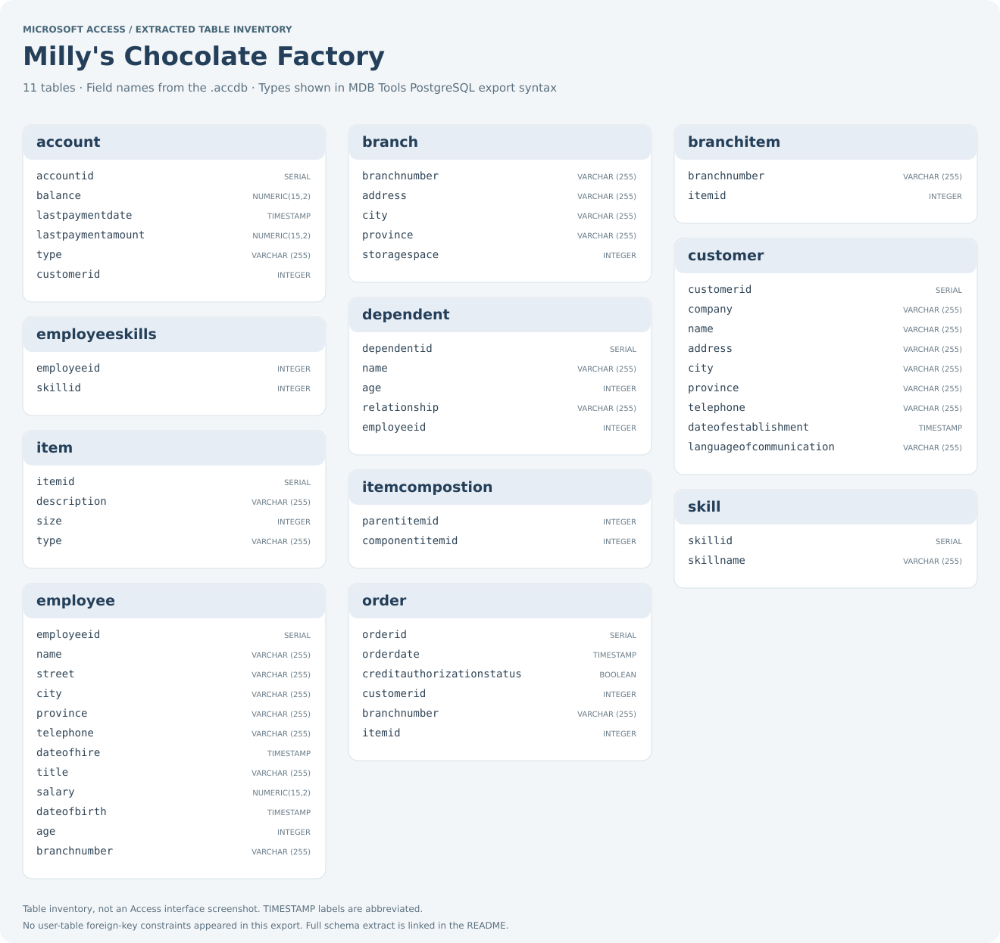

# Milly's Chocolate Factory Database

**Database Development coursework · Microsoft Access**

A Microsoft Access database created for Database Development coursework at Belgium Campus.

The Access file contains 11 tables covering customers, accounts, branches, items, orders, employees, skills and dependants. It explores how a business scenario can be represented as a database.

## Database structure preview

This inventory was extracted from the actual Access file. It shows stored table and field names, with PostgreSQL-style type labels produced by MDB Tools. It is a schema preview rather than an Access interface screenshot.

[Full schema extract](docs/screenshots/schema-export.sql) · [Capture provenance](docs/screenshots/capture.json)

The SQL export is a structural reference. The `.accdb` remains the original project; the extract does not reproduce Access forms, queries, reports or application behaviour.

## Project focus

- Identify entities and their relationships.
- Plan a relational data model.
- Implement related tables in Microsoft Access.
- Translate an entity relationship design into a working database file.

## Open the project

1. Download or clone the repository.
2. Open `Milly's Chocolate Factory.accdb` in Microsoft Access.
3. Inspect the database objects and use the Relationships window to explore the data model.

Use Microsoft Access for the original Access interface and editing workflow. You can inspect the table inventory and exported structure directly in this README without installing Access; GitHub cannot render the `.accdb` itself.

## Repository contents

| File | Description |
| --- | --- |
| `Milly's Chocolate Factory.accdb` | Microsoft Access database |
| `README.md` | Project overview and opening instructions |
| `.gitignore` | Excludes temporary Access lock files |
| `docs/screenshots/` | Extracted table inventory, schema reference and provenance |

The preview and schema extract provide a read-only view of the stored table structure. MDB Tools exported no foreign-key constraints between the project tables; ID fields alone should not be described as enforced relationships. Review and complete the intended relationships in Access before treating the model as fully validated.

## Skills practised

Relational database design · Entity relationships · Microsoft Access · Translating requirements into a data model

**Author:** Nkosinathi Mathenjwa

